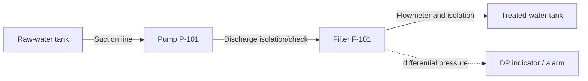

# Integrated case: pump → filter vessel → treated-water tank

**Purpose:** show how discrete know-how entries combine into an engineering workflow. This is a **conceptual** case, not a construction package.

## Inputs assumed for teaching only

- Water at moderate ambient temperature; target duty 50 m³/h.
- Static elevation differential 12 m at chosen reference liquid levels.
- Illustrative loss budget at 50 m³/h: 5 m straight-pipe, 1.2 m valves/fittings, 6 m filter.
- No specified filter vessel, pump model, site layout, pressure boundary, treatment chemistry or code jurisdiction.

## Sequence of engineering decisions

1. Define normal, min/max, backwash, start-up, shutoff and test cases; issue the operating-state matrix (PK-0001, PK-0059).
2. Obtain raw-water chemistry and decide the material class and fluid-compatible linings, gaskets and valves (PK-0036 to PK-0039).
3. Screen diameter and pressure loss on both suction and discharge paths (PK-0006, PK-0007).
4. Calculate NPSHA in the most adverse suction case and request actual OEM NPSHR curve/margin (PK-0010, PK-0011).
5. Construct system curves for clean/fouled filter states. Pump duty at 50 m³/h is 24.2 m in this **illustrative one-point budget** (PK-0009, PK-0012).
6. Provide maintainable valve/strainer arrangements, safe filter isolation, and instrument tapping and DP monitoring (PK-0017, PK-0020, PK-0052, PK-0054).
7. Examine air at peaks, drains at low points and filling/emptying operation (PK-0022, PK-0023, PK-0044).
8. Route with maintenance, support and nozzle-load constraints (PK-0021, PK-0025 to PK-0028).
9. Assess shutdown surges, check-valve dynamics, blocked-in overpressure and full operating-state envelope (PK-0018, PK-0034, PK-0056).
10. Reconcile P&ID, line list, line class, 3D model, isometrics, supports and quality plan (PK-0046 to PK-0051).

## Example calculated values

At 50 m³/h and total illustrative head 24.2 m, hydraulic power is about **3.296 kW**. Assuming 65% pump efficiency for a point estimate, shaft power is **5.071 kW**. Neither value selects the installed motor nor passes system hydraulics. See [example 04](04_pump_power.md).

## Missing information — design cannot be released yet

- Design pressure/temperature, pressure sources, water analysis, piping code, ratings and construction jurisdiction.
- Installed elevation profiles, pipe lengths/IDs, fittings, filter pressure-loss curves and pump performance envelope.
- Pump nozzle load allowances, suction installation details, support steel, anchors and thermal movement.
- Surge study, safe relief paths, instrumentation/control logic, startup/cleaning/testing procedures.

**Closing criterion:** create an actual engineering decision record for each design check, attach calculations and OEM/project evidence, and obtain project authority approval. The conceptual schematic alone is not approved plant documentation.
