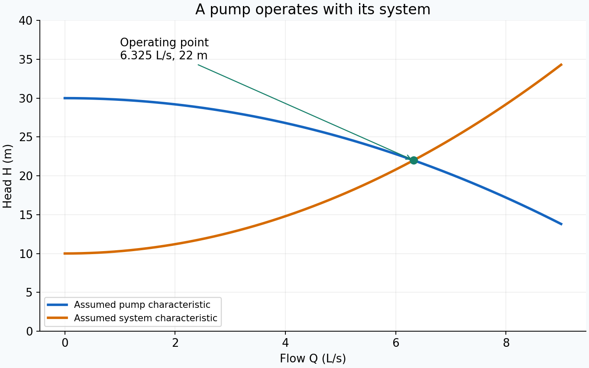
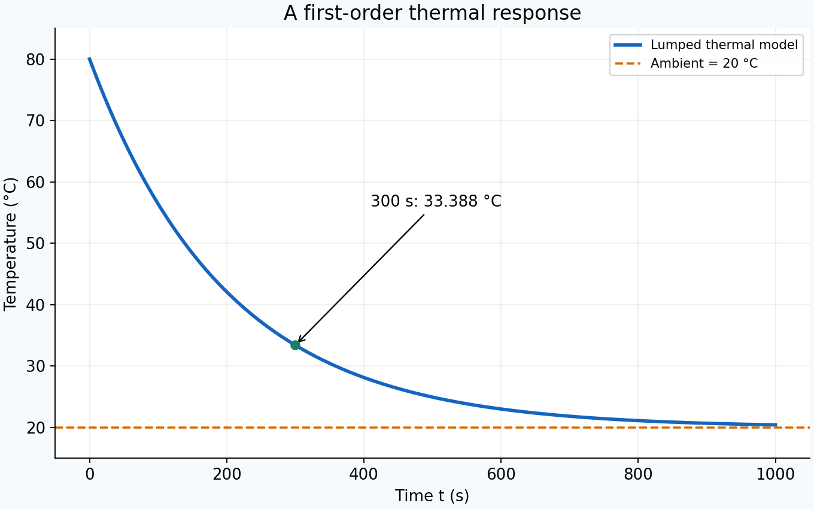
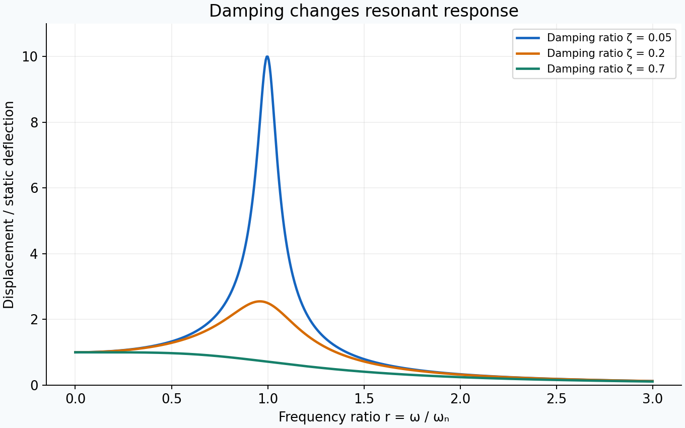
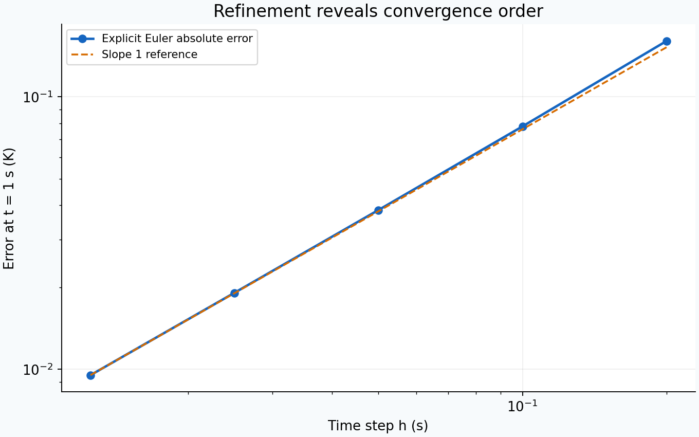
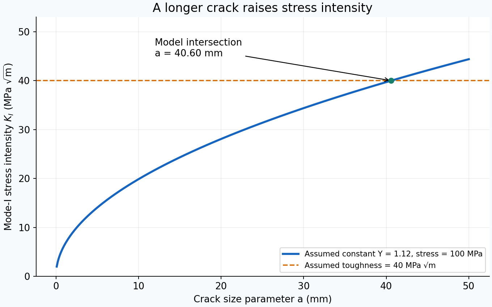
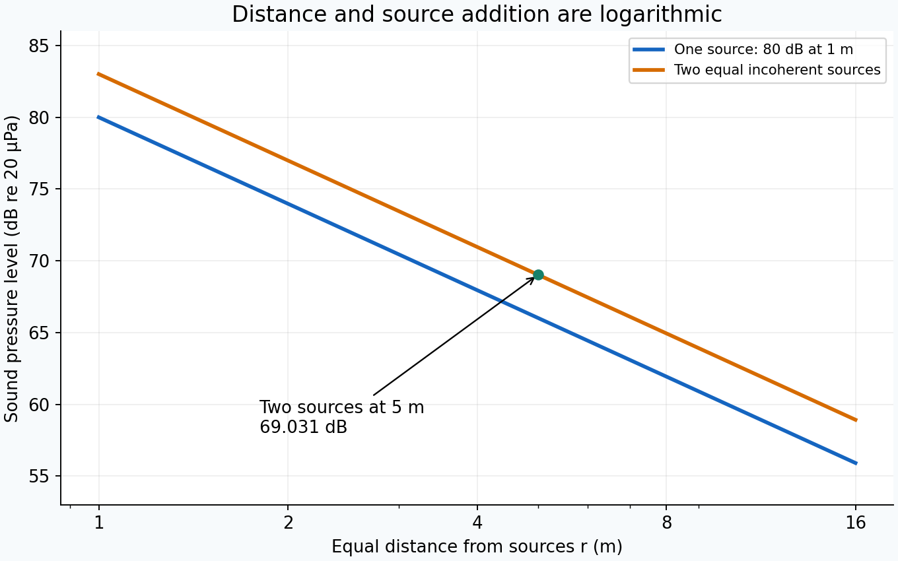

# Quantitative visual guide

These original figures are generated from the equations and assumed inputs below. They illustrate model behaviour, not measured equipment performance. Regenerate them with `python scripts/generate_figures.py` after installing NumPy and Matplotlib. All six plots are available as PNG for reading and SVG for scalable reuse.

## Pump operating point

For flow $Q$ in m³/s, the assumed pump curve is $H_p=30-200000Q^2$ m and the system curve is $H_s=10+300000Q^2$ m. Their intersection gives 6.325 L/s and 22 m. The graph displays flow in L/s, so its horizontal values must be converted before substitution into these equations. Read [systems engineering, Example 1](chapters/35-systems-engineering.md). [SVG](assets/pump-operating-point.svg).

## Thermal response

The lumped model is $T(t)=20+60e^{-t/200}$ °C with time in seconds. At 300 s it predicts 33.388 °C. The time constant is 200 s, and the model approaches ambient asymptotically. Read [engineering mathematics, Example 1](chapters/02-engineering-mathematics.md). [SVG](assets/thermal-response.svg).

## Vibration response

For a linear single-degree-of-freedom oscillator under harmonic force, $X/(F_0/k)=1/\sqrt{(1-r^2)^2+(2\zeta r)^2}$, where $r=\omega/\omega_n$. This is force-driven displacement amplification relative to static deflection; it is not the base-motion transmissibility. The three curves use damping ratios 0.05, 0.2, and 0.7. Read [vibrations](chapters/20-vibrations.md). [SVG](assets/vibration-response.svg).

## Numerical convergence

For $\dot\theta=-0.5\theta$ with initial excess temperature 10 K, the exact value at 1 s is $10e^{-0.5}$ K. The plotted error compares it with repeated explicit Euler steps. The first-order reference is scaled to the smallest-step error; it indicates the expected trend, not an independent error bound. Read [numerical methods, Example 2](chapters/03-numerical-methods.md). [SVG](assets/numerical-convergence.svg).

## Crack size and stress intensity

The teaching model uses $K_I=Y\sigma\sqrt{\pi a}$ with constant $Y=1.12$, stress 100 MPa, and hypothetical toughness 40 MPa $\sqrt{\mathrm m}$. The intersection is $a=(40/112)^2/\pi=0.040601\ \mathrm m$, approximately 40.60 mm. The plotted horizontal axis is in millimetres, but the equation uses metres for this stress-intensity unit. A constant geometry factor over this whole range is an illustration, not a finite-width crack solution. The plot does not establish small-scale yielding, toughness-test validity, inspection interval, or acceptance of a cracked part. Read [fracture mechanics](chapters/36-fracture-mechanics.md). [SVG](assets/fracture-intensity.svg).

## Sound addition and distance

Each assumed compact source produces 80 dB sound pressure level at 1 m. In the far-field free-field model, a single source gives $L_p(r)=80-20\log_{10}(r/1\ \mathrm m)$. Two equal mutually incoherent sources at the same distance give $L_{p,\mathrm{sum}}=L_p+10\log_{10}2$, or 69.031 dB at 5 m. The same-distance condition applies to the receiver, and the distance range must actually be in each source's far field. Reflections, atmospheric absorption, near-field structure, and phase coherence can change the result. This is unweighted level relative to 20 µPa; it is not an occupational exposure limit or a dBA measurement. Read [engineering acoustics](chapters/39-engineering-acoustics.md). [SVG](assets/sound-distance.svg).
